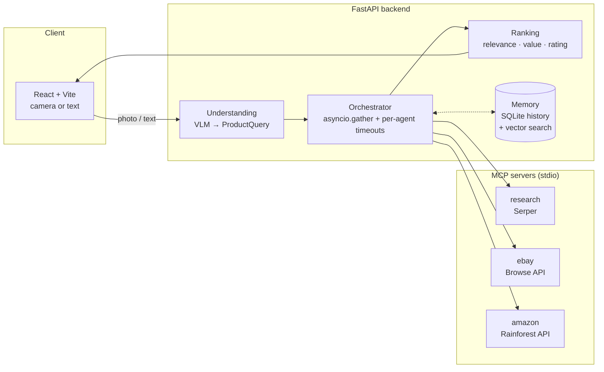

# CartLog AI

A multimodal shopping assistant. Point your phone camera at a product, or type what you want. A vision-language model turns the photo into a structured search. A research agent, an eBay agent and an Amazon agent then search **at the same time** over the Model Context Protocol (MCP), and the results come back as one ranked list.

It runs end to end with **no API keys**. Every agent falls back to deterministic mock data, so you can clone it and try it in two minutes.

## Architecture



1. **Understand.** A photo goes to a vision-language model (`gpt-4o-mini` by default), which returns JSON matching a `ProductQuery` schema: product, brand, model, attributes, budget and condition. Text goes through the same model, or through a rule-based parser when no key is set. A budget typed next to a photo ("under $80") overrides the model's guess.
2. **Fan out.** The orchestrator keeps one MCP session open to each agent server and calls all three with `asyncio.gather`. Each call has its own timeout. A slow or failing agent is reported in the timings but never fails the search.
3. **Rank.** Listings from both marketplaces are de-duplicated and scored: 60% title relevance, 30% value against the typical price the research agent found, and 10% rating.
4. **Remember.** Every search is saved to SQLite and embedded. The next search pulls up related past searches from the same session, using Pinecone when it's configured or local cosine similarity otherwise. This lookup runs alongside the agents, so it adds no wait.

## Measured: parallel vs sequential agents

`python benchmark.py --runs 12` (from `backend/`), mock agents with simulated API latency of about 0.7 s, 0.9 s and 1.1 s:

| Mode | Median | p95 |
|---|---|---|
| Sequential (one agent after another) | 2631 ms | 2930 ms |
| **Parallel fan-out over MCP** | **1077 ms** | **1274 ms** |

Parallel fan-out cuts median latency by **59%**. The total wait becomes the slowest agent instead of the sum of all three. These numbers come from simulated latencies. With live keys set, the same script measures the real APIs.

## Run it

**Requirements:** Python 3.10+ and Node 18+.

```bash
git clone https://github.com/ArunaSamhitha/CartLog-AI.git
cd CartLog-AI

cd backend
python -m venv .venv && source .venv/bin/activate
pip install -r requirements.txt
cp .env.example .env          # optional: add keys for live results
cd ../frontend && npm install && cd ..

./start.sh                    # API on :8000, UI on http://localhost:5173
```

Open the UI on your phone (same Wi-Fi, `npm run dev -- --host`) and the **＋ Photo** button opens the camera.

| Key | Enables | Without it |
|---|---|---|
| `OPENAI_API_KEY` | Photo search, LLM text parsing, learned embeddings | Rule-based text parsing, hashed embeddings, no photo search |
| `EBAY_CLIENT_ID` / `EBAY_CLIENT_SECRET` | Live eBay listings | Mock eBay listings |
| `RAINFOREST_API_KEY` | Live Amazon listings | Mock Amazon listings |
| `SERPER_API_KEY` | Live web research and price range | Mock research |
| `PINECONE_API_KEY` | Vector memory in Pinecone (index dimension 1536) | Vectors stored in SQLite |

## API

| Method | Path | Body |
|---|---|---|
| `POST` | `/api/search` | `{"text": "used sony headphones under $200", "session_id": "optional"}` |
| `POST` | `/api/search/image` | multipart: `image` (JPEG/PNG/WebP ≤ 8 MB), optional `note`, `session_id` |
| `GET` | `/api/history/{session_id}` | |
| `GET` | `/api/health` | |

Every response includes per-agent timings, so the UI can show which agent was slowest.

## Tests

```bash
cd backend && pytest -q
```

12 tests cover the text parser, ranking, memory recall (including session isolation), and the orchestrator against the real MCP servers: all three agents answering, parallel beating sequential, and a timed-out agent not failing the search.

## Project layout

```
backend/
  cartlog/
    api.py            FastAPI routes; starts the MCP servers on startup
    service.py        The pipeline: understand → fan out → rank → remember
    understanding.py  Vision / text → ProductQuery (LLM or rule-based)
    orchestrator.py   MCP client sessions, parallel calls, timeouts
    ranking.py        Merge, de-duplicate and score listings
    memory.py         SQLite history + vector recall (Pinecone or local)
    schemas.py        Pydantic models shared across the app
  mcp_servers/        research, ebay and amazon MCP servers
  tests/
  benchmark.py
frontend/             React + Vite UI
docs/HOW_IT_WORKS.md  Design walkthrough and interview notes
```

## Limitations

- Rainforest and Serper are paid APIs with free tiers. eBay's Browse API needs a free developer account.
- The ranking weights are hand-tuned rather than learned from clicks.
- Photo search depends on what the model can read. A product with no visible branding becomes a generic search.

## License

MIT
